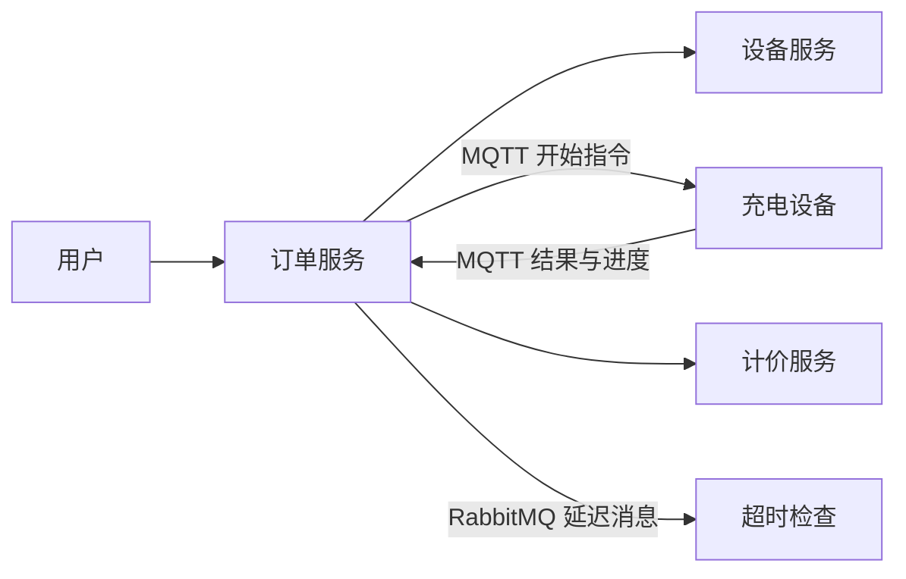

# Charing-Cloud｜充电桩云端业务原型

Charing-Cloud 是一个 Java 多模块充电业务项目。它把**设备管理、充电订单、进度计价、用户和网关**拆成服务，重点展示云端如何向充电桩发送指令、接收设备消息并计算费用。当前仍是原型，部分结算与异常处理尚未完成。

## 业务关系

## 一次充电请求如何流转

1. 用户发起充电请求，[订单接口](charging-order/src/main/java/cn/tedu/charging/order/controller/OrderController.java) 接收站点、充电桩和充电枪等参数。
2. [订单服务](charging-order/src/main/java/cn/tedu/charging/order/service/impl/OrderServiceImpl.java) 调用设备服务更新枪状态，通过 MQTT 向设备发送开始指令，同时发出 RabbitMQ 延迟检查消息。
3. 设备回传启动结果和进度后，[MQTT 消费者](charging-order/src/main/java/cn/tedu/charging/order/mqtt/MqttConsumer.java) 处理消息。进度处理路径会调用计价服务、推送并保存充电数据。
4. [计价服务](charging-cost/src/main/java/cn/tedu/charging/cost/service/impl/CostServiceImpl.java) 按站点、枪类型和当前时段匹配计价规则，根据累计电量计算本次用量与累计费用。
5. 若设备在延迟检查时仍没有返回结果，[RabbitMQ 消费者](charging-order/src/main/java/cn/tedu/charging/order/rabbit/RabbitMQConsumer.java) 会记录失败订单。

## 服务与技术

| 模块 | 负责内容 |
| --- | --- |
| `charging-device` | 站点查询、充电枪状态 |
| `charging-order` | 订单创建、MQTT 消息、进度与超时检查 |
| `charging-cost` | 分时计价规则与费用计算 |
| `charging-user` | 用户信息 |
| `charging-gateway` | 服务网关 |

项目使用 Spring Boot、Spring Cloud/Nacos、OpenFeign、MyBatis-Plus、MySQL、Redis、MQTT、RabbitMQ、Elasticsearch 和 WebSocket。可从 [根 Maven 工程](pom.xml) 查看模块与依赖。

## 已知未完成部分

- 订单号生成方法目前固定返回 `666`，还不是唯一订单号。
- 高温、余额不足、充满后的结算等处理在消息消费者中仍是注释；超时后修改枪状态及通知用户也尚未实现。
- 仓库提供 [数据库脚本](doc/charging.sql)，但没有一键部署配置。运行需要自行准备 MySQL、Nacos、Redis、RabbitMQ 和 MQTT Broker 等依赖，并替换示例连接配置。
- 本文依据静态源码核查，未进行设备联调或全链路运行验证。
